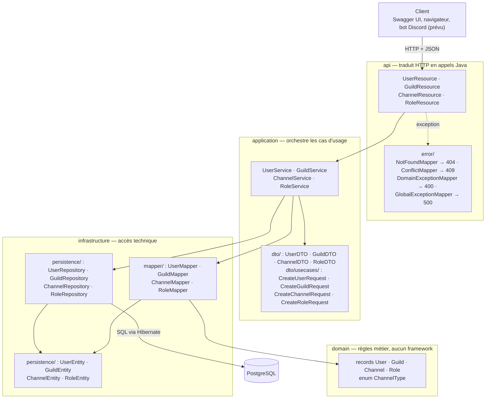
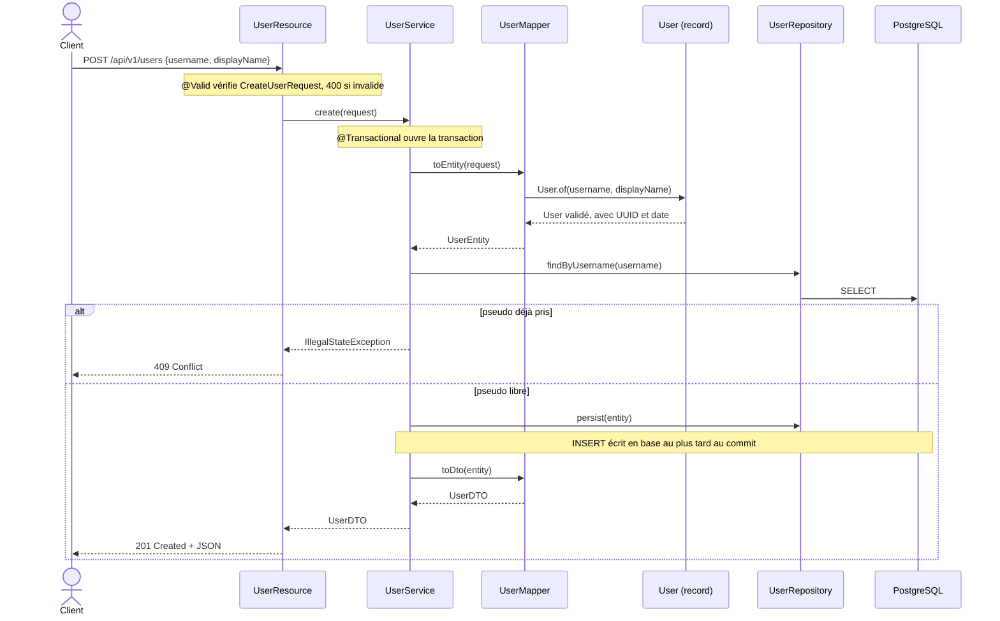

# Architecture — API Discord (I311)

Application Quarkus organisée en **4 couches**, sur le modèle du starter.
Le modèle de données (classes, cardinalités, contraintes) est décrit dans
[modele-uml.md](modele-uml.md).

## Vue d'ensemble



**Règle de dépendance :** l'`api` n'appelle que l'`application` ; le `domain` ne dépend
d'aucune autre couche ni d'aucun framework. Ces règles sont vérifiées automatiquement
par les tests ArchUnit (`src/test/java/org/acme/architecture/`).

## Rôle de chaque fichier

Les quatre entités suivent le même schéma. Exemple avec `User` :

| Couche | Fichier | Rôle |
| --- | --- | --- |
| api | `UserResource` | Associe chaque URL à une méthode Java et renvoie le code HTTP adapté. |
| api | `error/*Mapper` | Traduit une exception Java en réponse HTTP (400, 404, 409, 500). |
| application | `UserService` | Enchaîne les étapes d'un cas d'usage dans une transaction (`@Transactional`). Ne connaît pas HTTP. |
| application | `UserDTO` | Forme du JSON **renvoyé** au client. |
| application | `CreateUserRequest` | Forme du JSON **reçu** à la création, validé par Bean Validation (`@NotBlank`). |
| domain | `User` | Record immuable. Son constructeur refuse les données invalides ; `User.of()` génère l'UUID et la date. |
| infrastructure | `UserEntity` | Correspondance avec la table `users` (`@Entity`, `@Id`, `@Column`). Aucune règle métier. |
| infrastructure | `UserRepository` | Seul point d'accès à la base. Hérite des opérations CRUD de Panache. |
| infrastructure | `UserMapper` | Traduit entre les modèles : requête → domaine → entité, et entité → DTO. |

## Trajet d'une requête : création d'un utilisateur



## Codes HTTP

| Code | Déclencheur | Traduit par |
| --- | --- | --- |
| 201 | Création réussie | la ressource (`Response.status(CREATED)`) |
| 204 | Suppression réussie | la ressource (`Response.noContent()`) |
| 400 | Payload invalide (`@NotBlank`…) ou règle du domaine violée (`IllegalArgumentException`) | Bean Validation / `DomainExceptionMapper` |
| 404 | Ressource absente (`NoSuchElementException`) | `NotFoundMapper` |
| 409 | Doublon : pseudo, ou nom de salon / rôle déjà pris dans la guilde (`IllegalStateException`) | `ConflictMapper` |
| 500 | Erreur imprévue | `GlobalExceptionMapper` |

## Relations implémentées

- `Channel` → `Guild` et `Role` → `Guild` : `@ManyToOne`, clé étrangère `guild_id`
  portée par `Channel` et `Role` (côté propriétaire).
- `Guild` → `Channel` / `Role` : `@OneToMany(mappedBy = "guild")`, côté inverse, avec
  `cascade = ALL` et `orphanRemoval = true` : supprimer une guilde supprime ses salons et ses rôles
  (composition dans l'UML).
- Unicité du nom de salon et de rôle **par guilde** : `@UniqueConstraint(guild_id, name)`.

J'ai modélisé le domaine en UML, avec User, Guild, Channel et Role et leurs cardinalités, dans docs/. J'ai un CRUD REST qui fonctionne sur les quatre entités, avec PostgreSQL. Les identifiants sont des UUID générés par l'application.


**Pas encore implémenté :** `User ↔ Guild` et `User ↔ Role` (`@ManyToMany`).

## Lancer l'application en local

```bash
docker start product-catalog-postgres
DB_PORT=15432 ./mvnw quarkus:dev
```

Swagger UI : <http://localhost:8080/swagger-x/>

